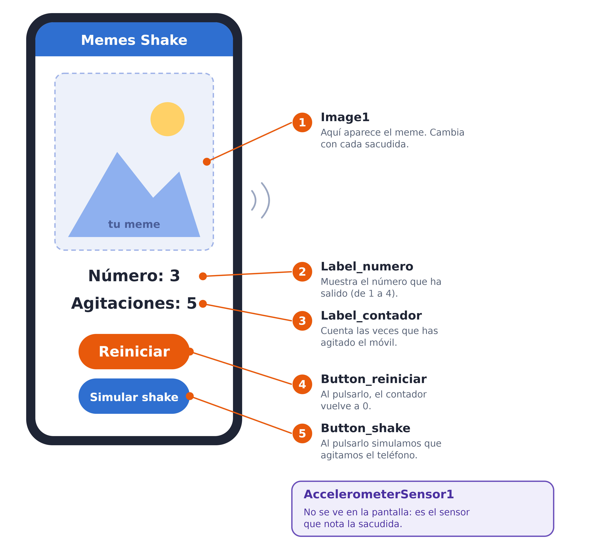

# Práctica: Memes Shake

Vas a crear una app que cambia de meme cada vez que sacudes el móvil y que cuenta cuántas veces lo has agitado.

## Así quedará tu app

Mira el dibujo: tu pantalla tendrá cinco cosas que se ven (la imagen, dos textos y dos botones) y un sensor que no se ve, pero que nota cuando sacudes el móvil.

    

Los dibujos de esta ficha son esquemas para guiarte. En tu pantalla de Thunkable los colores y la forma de los bloques pueden verse un poco distintos.

## Antes de empezar

Prepara estas cosas:

- Descarga al menos cuatro imágenes divertidas y apropiadas para la clase.
- Crea un proyecto nuevo en Thunkable.
- Sube las imágenes a tu proyecto en `Design`, apartado `Assets`. Renombra las imágenes para que se llamen: `meme1`, `meme2`, `meme3` y `meme4`.

## Sigue los pasos:

[Aquí tienes una presentación con los pasos para crear la aplicación y la parte que tú tienes que hacer.](https://docs.google.com/presentation/d/1MD6WS_mJLQ6KgO7FzFylHk56MSPDAWVlIcNketilWcU/edit?usp=sharing)

## Pistas:

- El bloque «join» está en el cajón Text. Une el texto «Agitaciones: » con el valor del contador.
- Para sumar, usa un bloque de suma del cajón Math con get contador y un 1.

## Comprueba tu aplicación

Probad la app y marcad cada punto cuando funcione:

- Al abrirla, el contador empieza en 0.
- Al agitar el teléfono, cambia el número.
- Al agitarlo, aparece la imagen que corresponde al número.
- Al agitarlo, el contador aumenta en 1.
- Tras varias agitaciones, el contador indica cuántas veces lo has agitado.
- Al pulsar Reiniciar, el contador vuelve a 0.

## Si algo no funciona

| Qué pasa | Qué revisar |
| --- | --- |
| No cambia nada al agitar | ¿Has arrastrado AccelerometerSensor a la pantalla? ¿Está en tu evento Shaking todo lo que debe pasar? |
| El número cambia, pero la imagen no | ¿Has subido las cuatro imágenes? ¿Elegiste la imagen correcta en cada bloque if? |
| El contador no sube | ¿El bloque de sumar está dentro del evento Shaking? |
| Reiniciar no hace nada | ¿El evento del botón usa Button\_reiniciar.Click y pone el contador a 0? |
