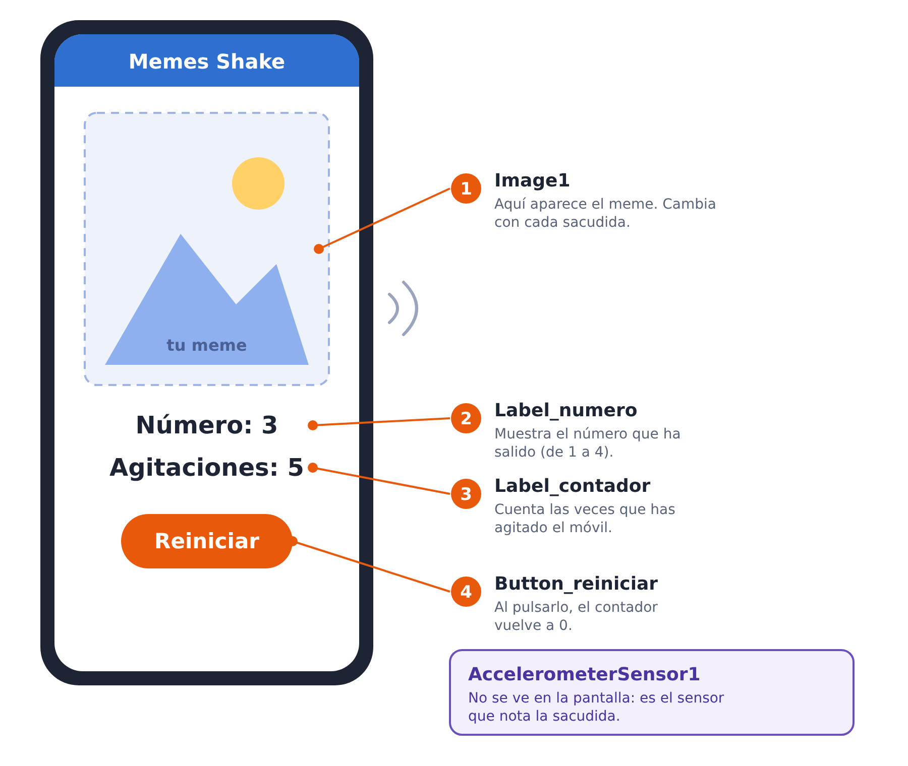
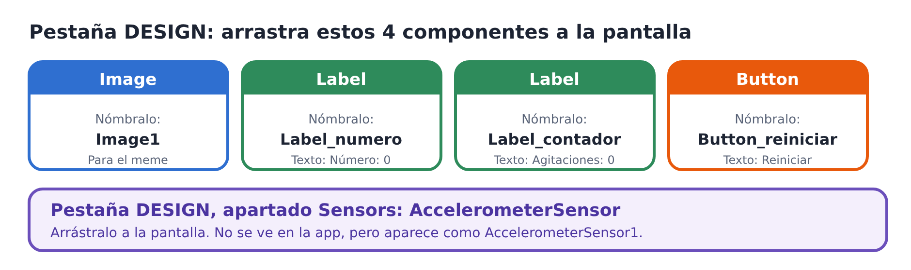
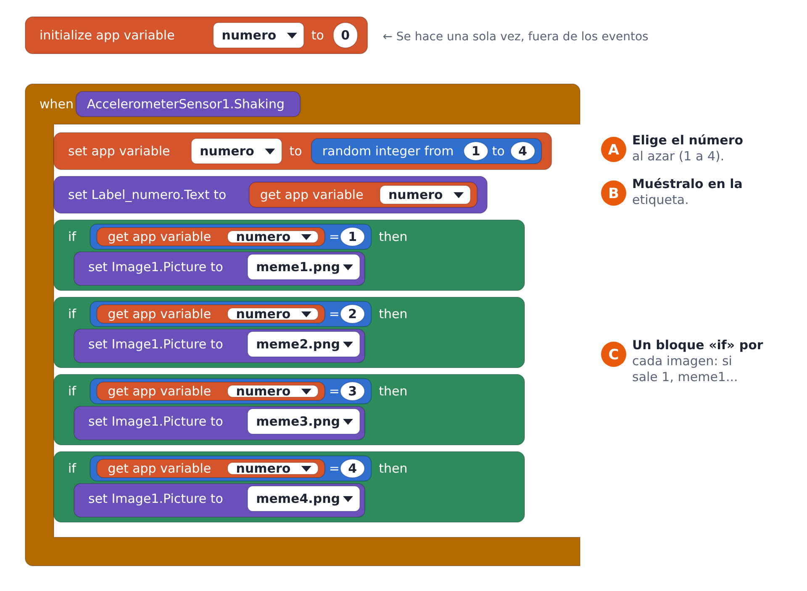
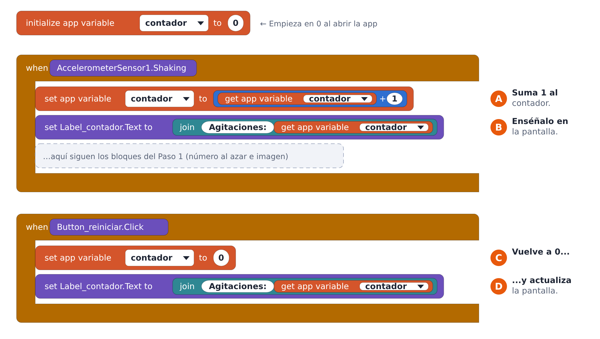

# Práctica: Memes Shake

Vas a crear una app que cambia de meme cada vez que sacudes el móvil y que cuenta cuántas veces lo has agitado.

## Así quedará tu app

Mira el dibujo: tu pantalla tendrá cuatro cosas que se ven (la imagen, dos textos y un botón) y un sensor que no se ve, pero que nota cuando sacudes el móvil.

Los dibujos de esta ficha son esquemas para guiarte. En tu pantalla de Thunkable los colores y la forma de los bloques pueden verse un poco distintos.

## Antes de empezar

Prepara estas cosas y ve marcándolas:

- Cuatro imágenes divertidas y apropiadas para la clase, guardadas con los nombres meme1, meme2, meme3 y meme4.
- Un proyecto nuevo en Thunkable.
- Las imágenes subidas a tu proyecto (en Design, apartado Assets).

En la pestaña Design arrastra estos componentes a la pantalla y ponles nombre como en el dibujo:

Pon el texto inicial «Número: 0» y «Agitaciones: 0» a las dos etiquetas, y «Reiniciar» al botón.

## Paso 1: imágenes al azar

Ahora pasa a la pestaña Blocks. Cada vez que agites el móvil debe pasar esto:

1. La app elige un número al azar entre 1 y 4 (bloque A).
2. Muestra ese número en la etiqueta (bloque B).
3. Según el número, cambia la imagen: si sale 1, meme1; si sale 2, meme2; y así hasta el 4 (bloques C).

Pistas:

- El bloque naranja «initialize app variable» va solo, fuera de los eventos. Cámbiale el nombre a numero.
- El evento «Shaking» está en el cajón de AccelerometerSensor1.
- «random integer from 1 to 4» está en el cajón Math.
- Haz el primer «if» y luego duplícalo (clic derecho, Duplicate) cambiando el número y la imagen.

## Paso 2: contador de agitaciones

Añade un contador que cuente tus sacudidas y un botón para ponerlo a cero:

1. Crea la variable contador, que empieza en 0.
2. En el mismo evento Shaking del Paso 1, súmale 1 al contador (bloque A) y enséñalo en la etiqueta (bloque B). Los bloques del Paso 1 se quedan donde están.
3. Crea un evento nuevo para el botón: al pulsar Reiniciar, el contador vuelve a 0 (C) y la etiqueta se actualiza (D).

Pistas:

- El bloque «join» está en el cajón Text. Une el texto «Agitaciones: » con el valor del contador.
- Para sumar, usa un bloque de suma del cajón Math con get contador y un 1.

## Comprueba tu aplicación

Probad la app y marcad cada punto cuando funcione:

- Al abrirla, el contador empieza en 0.
- Al agitar el teléfono, cambia el número.
- Al agitarlo, aparece la imagen que corresponde al número.
- Al agitarlo, el contador aumenta en 1.
- Tras varias agitaciones, el contador indica cuántas veces lo has agitado.
- Al pulsar Reiniciar, el contador vuelve a 0.

## Si algo no funciona

| Qué pasa | Qué revisar |
| --- | --- |
| No cambia nada al agitar | ¿Has arrastrado AccelerometerSensor a la pantalla? ¿Está en tu evento Shaking todo lo que debe pasar? |
| El número cambia, pero la imagen no | ¿Has subido las cuatro imágenes? ¿Elegiste la imagen correcta en cada bloque if? |
| El contador no sube | ¿El bloque de sumar está dentro del evento Shaking? |
| Reiniciar no hace nada | ¿El evento del botón usa Button\_reiniciar.Click y pone el contador a 0? |

