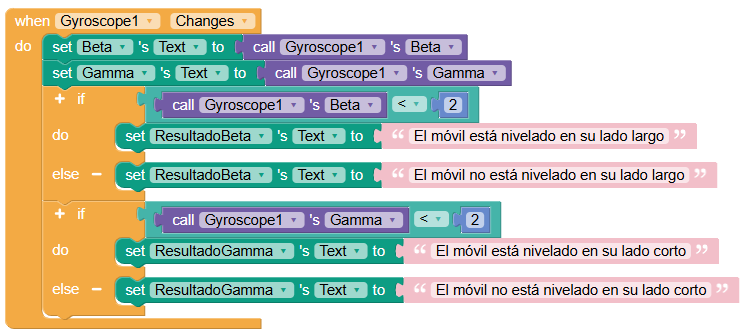
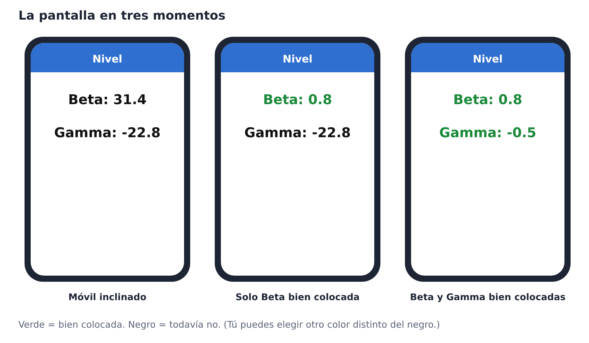
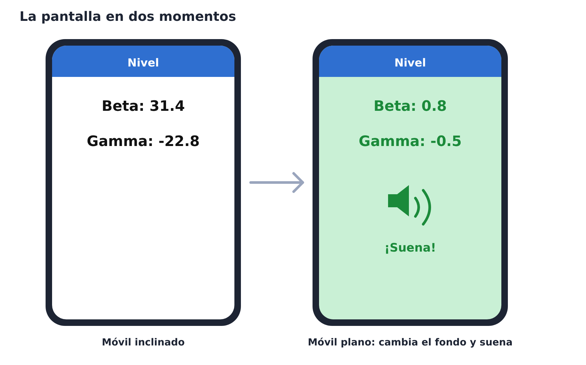
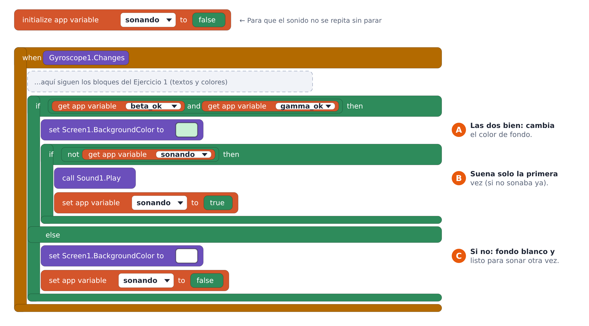

# Práctica: Un nivel con Thunkable

Vas a convertir tu móvil en un nivel: la app te dirá si está colocado plano sobre una superficie, y avisará con colores y sonido.

## Punto de partida

Abre [este enlace](https://x.thunkable.com/copy/813c65fc3885e5f398d3b8fac124f7b8) y haz una copia en tu cuenta de Thunkable. Es una app que usa el giroscopio del móvil para comprobar si está colocado plano sobre una superficie.

Antes de cambiar nada, pruébala:

- Pon el móvil plano sobre la mesa y anota qué valores marcan Beta y Gamma.
- Inclínalo y mira cómo cambian los valores.

Beta y Gamma son dos giros distintos del móvil. Cuando los dos están bien colocados, el móvil está plano.

### Código del programa

Fíjate en el código de programa.

- Cuando *Beta* es menor que 2, consideramos que el móvil está plano respecto de su lado largo.
- Cuando *Gamma* es menor que 2, consideramos que el móvil está plano respecto de su lado corto.

## Ejercicio 1: colorea lo que está bien

Haz que cuando Beta esté bien colocada, su texto aparezca en un color distinto del negro. Haz lo mismo con Gamma, cada una por separado.

Pistas:

- El evento «Gyroscope1.Changes» se ejecuta cada vez que el móvil se mueve. Los bloques del color van dentro.
- «abs» (valor absoluto) está en el cajón Math. Quita el signo, así que -3 y 3 valen igual.
- Prueba con tolerancia 5 y cámbiala si es muy difícil o muy fácil acertar.
- La propiedad del color del texto es «TextColor» de cada etiqueta.

## Ejercicio 2: fondo y sonido

Cuando Beta y Gamma estén bien colocadas a la vez, el fondo de la pantalla cambia a otro color y suena un sonido.

La idea es:

1. Añade un componente Sound (apartado Media) y sube el sonido que quieras.
2. Si *beta es ok* y *gamma es ok* son verdaderas a la vez, cambia el color de fondo de la pantalla.
3. Haz sonar el sonido solo cuando antes no sonaba. Para eso necesitas una variable (sonando), porque el evento se repite muchas veces por segundo.
4. Si no están las dos bien, vuelve al fondo blanco y deja la variable lista para la próxima vez.

Así pueden quedar los bloques (añade esto al evento del Ejercicio 1):

Pistas:

- «and» y «not» están en el cajón Logic.
- La propiedad del fondo es «BackgroundColor» de Screen1.
- Si no pones la variable sonando, el sonido se repite sin parar.

## Comprueba tu aplicación

Probad la app y marcad cada punto cuando funcione:

- Con el móvil inclinado, los dos textos están en negro.
- Cuando solo Beta está bien, solo el texto de Beta cambia de color.
- Cuando solo Gamma está bien, solo el texto de Gamma cambia de color.
- Cuando las dos están bien, cambia el fondo de la pantalla.
- Cuando las dos están bien, suena el sonido una sola vez.
- Al inclinar el móvil de nuevo, todo vuelve al estado inicial.

## Si algo no funciona

| Qué pasa | Qué revisar |
| --- | --- |
| Los textos nunca cambian de color | ¿Están los bloques dentro del evento Gyroscope1.Changes? Mira si tu valor plano es 0 y si la tolerancia es razonable. |
| Siempre salen en verde, aunque esté inclinado | La tolerancia es demasiado grande. Reduce el número. |
| El color cambia, pero el fondo no | ¿El bloque if de las dos condiciones usa and y no or? |
| El sonido se repite sin parar | ¿Usas la variable sonando? Debe pasar a true al sonar y a false al inclinar. |
| No suena nada | ¿Has subido el sonido y lo has elegido en Sound1? ¿Tienes el volumen del móvil activado? |
