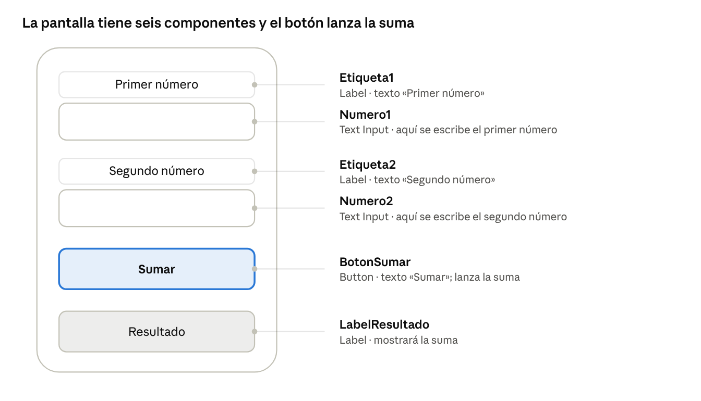
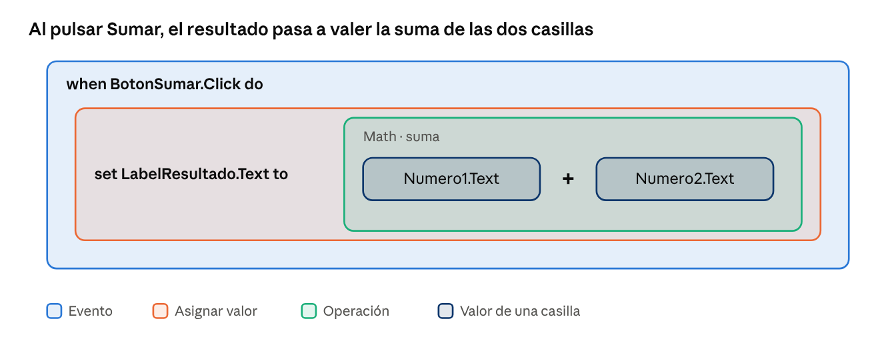

# Guía Thunkable: app que suma dos números

## Objetivo

Vamos a crear en Thunkable una app de una sola pantalla que suma dos números: la persona escribe un número en cada casilla, pulsa el botón y el resultado aparece debajo.

La pantalla tendrá seis componentes:

- 2 etiquetas (Label) que explican qué número va en cada casilla.
- 2 campos de texto (Text Input) donde se escriben los números.
- 1 botón (Button) que lanza la suma.
- 1 etiqueta de resultado (Label) que muestra el total.

El código son solo 5 bloques encajados, que verás en el Paso 4.

## Paso 1: crear el proyecto

1. Entra en thunkable.com e inicia sesión (la cuenta gratuita basta).
2. Pulsa **Create New App** (crear nueva app).
3. Ponle nombre, por ejemplo `SumaDosNumeros`, y confirma.
4. Se abre el editor con tres zonas: la lista de componentes a la izquierda, el móvil de muestra en el centro y las propiedades a la derecha. Arriba verás dos pestañas: **Design** (diseño) y **Blocks** (bloques).

## Paso 2: diseñar la pantalla

En la pestaña **Design**, arrastra los componentes desde la lista de la izquierda hasta el móvil, en este orden de arriba abajo:

1. **Label** (etiqueta): escribe en su propiedad *Text* "Primer número".
2. **Text Input**: es la casilla donde se escribe el primer número.
3. **Label**: escribe "Segundo número".
4. **Text Input**: la casilla del segundo número.
5. **Button**: cambia su texto a "Sumar".
6. **Label** final: déjala con el texto "Resultado"; aquí aparecerá la suma.

La ilustración muestra cómo debe quedar la pantalla y qué componente es cada uno.

Cada línea une un componente con el nombre que le pondrás en el Paso 3.

## Paso 3: poner nombre a los componentes

Todos los componentes se llaman por defecto `Label1`, `TextInput1`, etc. Para no confundirte en los bloques, selecciona cada uno y cambia su nombre en la parte superior del panel de propiedades:

| Componente | Nombre por defecto | Nombre sugerido |
| --- | --- | --- |
| Primera etiqueta | Label1 | Etiqueta1 |
| Primera casilla | TextInput1 | Numero1 |
| Segunda etiqueta | Label2 | Etiqueta2 |
| Segunda casilla | TextInput2 | Numero2 |
| Botón | Button1 | BotonSumar |
| Etiqueta final | Label3 | LabelResultado |

Los nombres por defecto pueden variar según la versión de Thunkable; lo importante es que uses los nombres sugeridos. Evita espacios y tildes. Si el campo de texto tiene una propiedad de tipo de teclado, elige el numérico para que solo se puedan teclear números.

## Paso 4: programar con bloques

Pasa a la pestaña **Blocks**. A la izquierda tienes los cajones de bloques, uno por componente y uno por tipo (Math, Text, Control...). Monta el programa así:

1. En el cajón de **BotonSumar**, arrastra el bloque `when BotonSumar.Click do` (cuando se pulse el botón). Todo lo que pongas dentro se ejecuta al pulsar.
2. En el cajón de **LabelResultado**, arrastra el bloque `set LabelResultado.Text to` y encájalo dentro del anterior.
3. En el cajón **Math**, arrastra el bloque de suma `+` y conéctalo al hueco del bloque `set`.
4. En el cajón de **Numero1**, arrastra el bloque `Numero1.Text` al primer hueco de la suma.
5. En el cajón de **Numero2**, arrastra el bloque `Numero2.Text` al segundo hueco.

El resultado final es un único grupo de bloques encajados, como el de la ilustración.

Los colores solo distinguen el tipo de bloque en esta ilustración; en Thunkable los colores de los bloques pueden ser distintos.

## Paso 5: probar la app

1. Instala la app **Thunkable Live** en tu móvil e inicia sesión con tu cuenta, o usa el botón de prueba en el navegador.
2. Pulsa el botón de prueba (Test) del editor y elige tu dispositivo.
3. Escribe un 4 en la primera casilla y un 3 en la segunda.
4. Pulsa **Sumar**: la etiqueta final debe mostrar 7.

## Problemas frecuentes

- **Sale 43 en vez de 7**: Thunkable está uniendo los textos en lugar de sumarlos. Convierte cada valor a número con un bloque de conversión del cajón Math antes de sumar.
- **No pasa nada al pulsar**: revisa que los bloques estén encajados dentro de `when BotonSumar.Click` y no sueltos en el área de trabajo.
- **No encuentro un bloque**: comprueba que has renombrado bien el componente; el cajón lleva el nombre nuevo.
- **El resultado sale vacío**: puede que una casilla esté sin rellenar al pulsar el botón.
